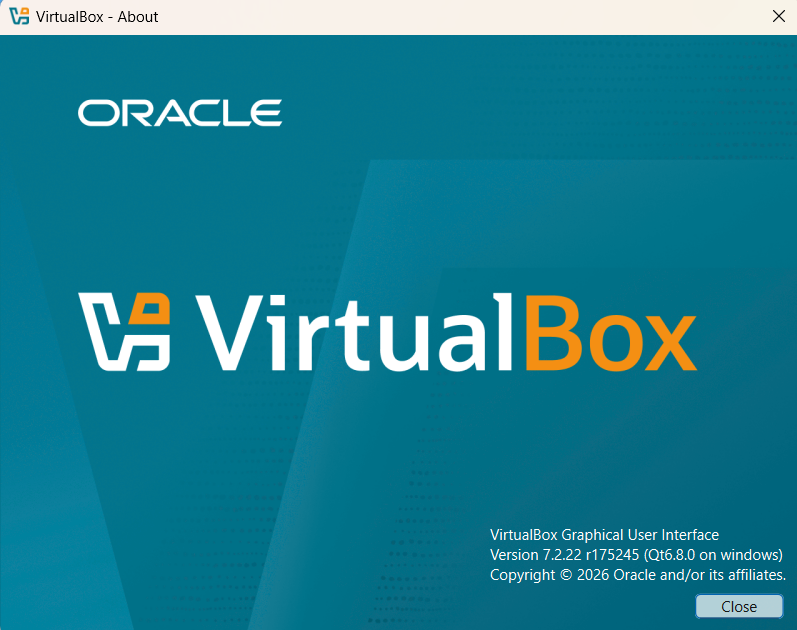
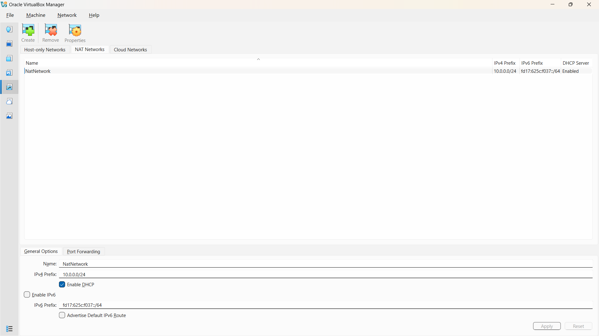
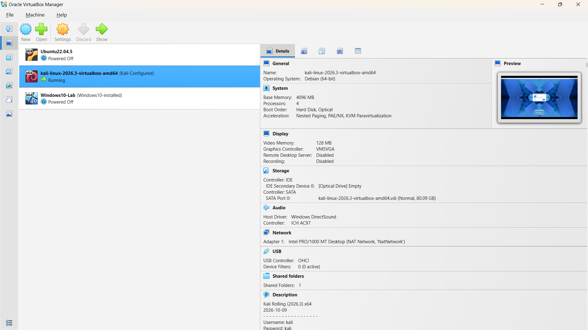
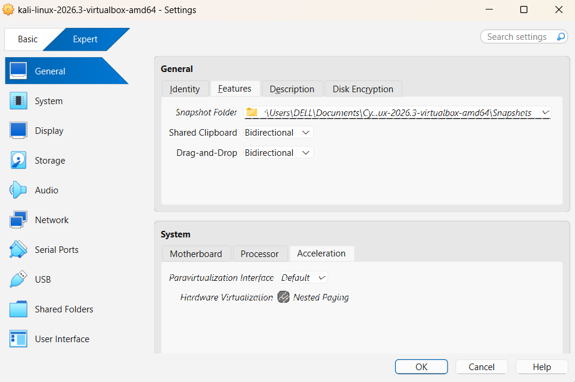
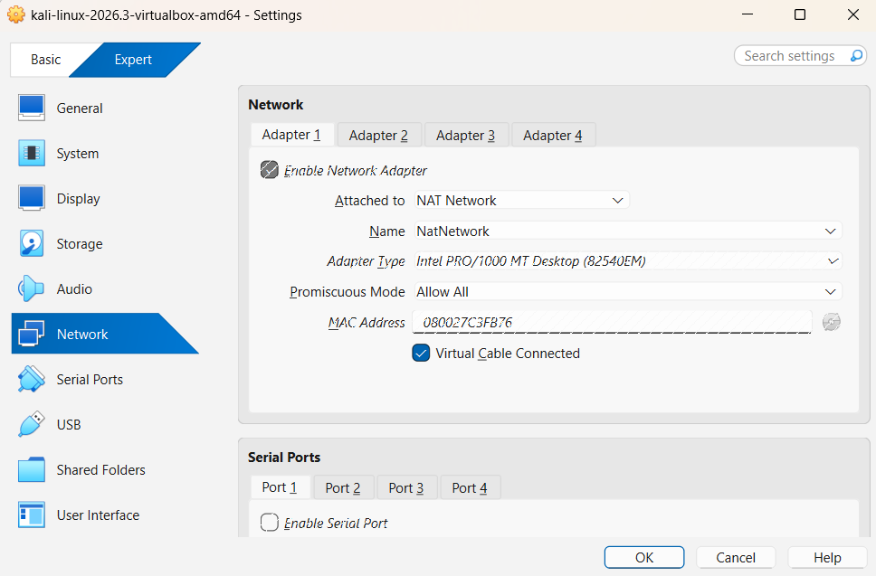
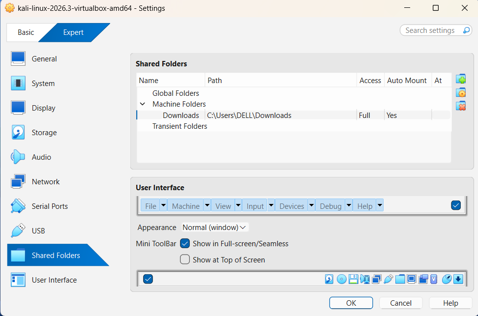
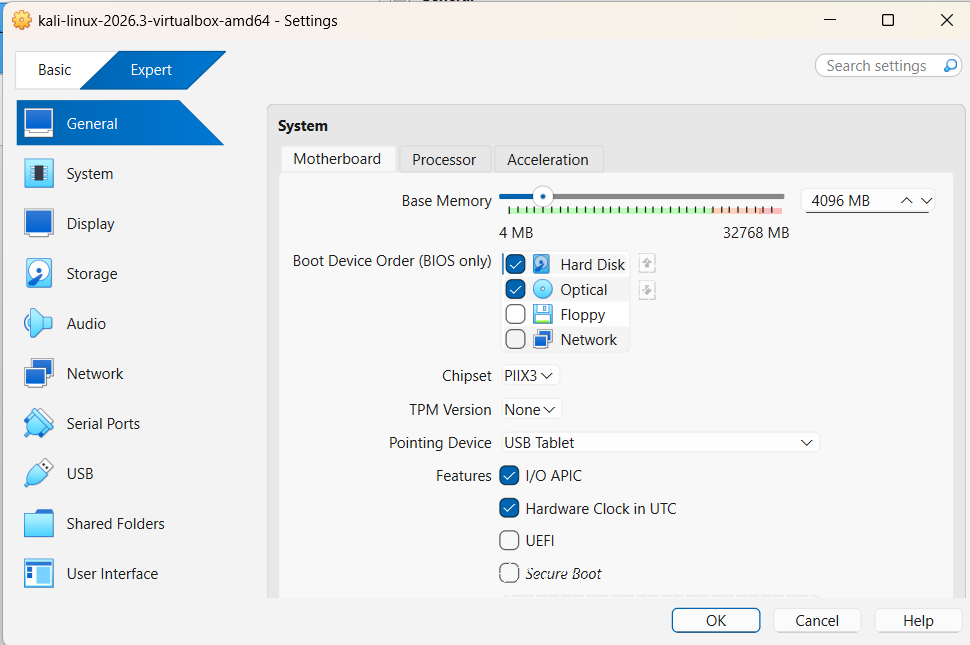
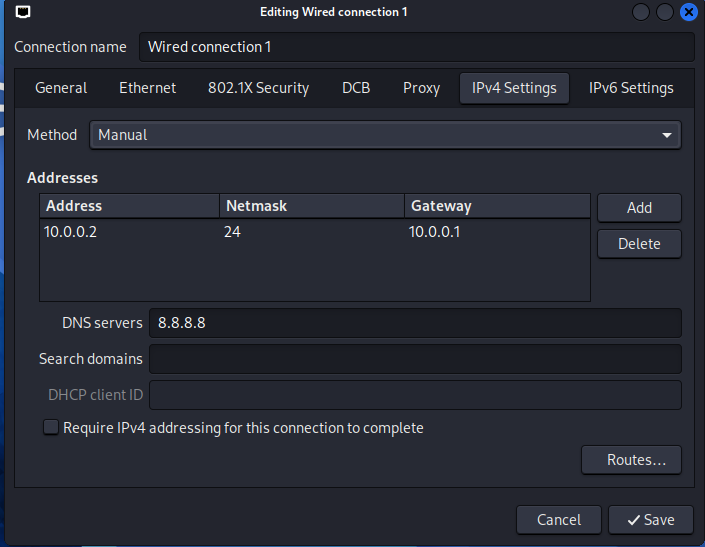
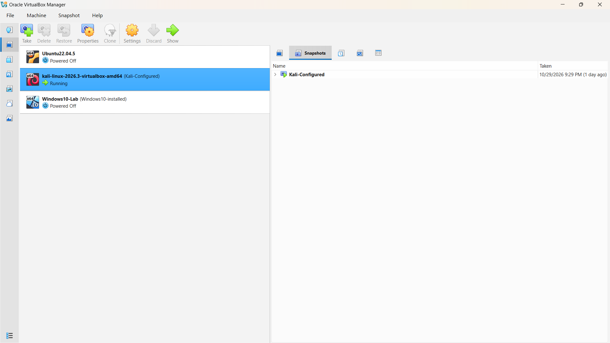
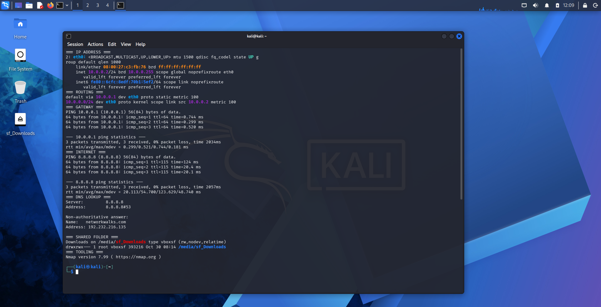

<div align="center">

# 🔐 Cybersecurity Lab Environment Setup

**Building an isolated virtual lab for penetration testing and ethical hacking practice**
</div>

<p align="center">
  
  
  
  
  
  
  
  
  
  
</p>

---

## 📌 Project Overview

This project builds a **virtual cybersecurity and penetration-testing laboratory** on a single laptop using VirtualBox and Kali Linux.

The lab exists to give security tooling a place to run where mistakes are cheap. Scanning, reconnaissance, vulnerability assessment and exploitation practice all behave differently against real infrastructure than against slides, and the only responsible way to learn that difference is inside an environment you fully own.

Everything here runs on a private virtual network with no path to any third-party system. Additional target machines can join the same subnet in later weeks without changing the design.

---

## 🎯 Objectives

- Install and configure VirtualBox as the lab hypervisor
- Import Kali Linux as the attacking machine
- Create an isolated NAT Network for the laboratory
- Assign a fixed IPv4 address to the Kali VM
- Enable host-to-guest clipboard, drag & drop and folder sharing
- Verify routing, DNS resolution and outbound connectivity
- Capture a clean snapshot as a recovery baseline
- Document the build, including faults encountered and how they were resolved

---

## 🛡️ Purpose of the Lab

Once complete, the environment supports:

- Network reconnaissance and host discovery
- Port scanning and service enumeration
- Vulnerability assessment
- Packet capture and traffic analysis
- Web application security testing
- Controlled exploitation practice
- General security-tool experimentation

⚠️ **Important:** this laboratory may only be used against machines you own or have explicit written permission to test.

---

## 🏗️ Lab Architecture

```
                    HOST MACHINE (Windows)
                   Physical NIC — ISP network
                              │
            ┌─────────────────┴─────────────────┐
            │     VirtualBox NAT Network        │
            │     "NatNetwork" — 10.0.0.0/24    │
            │     Gateway / DNS: 10.0.0.1       │
            └─────────────────┬─────────────────┘
                              │
        ┌─────────────┬───────┴───────┬──────────────┐
        │             │               │              │
  ┌───────────┐ ┌───────────┐  ┌───────────┐  ┌───────────┐
  │   KALI    │ │ Windows10 │  │ Windows11 │  │  Android  │
  │ ATTACKER  │ │  (future) │  │  (future) │  │  (future) │
  │ 10.0.0.2  │ │ 10.0.0.10 │  │ 10.0.0.11 │  │ 10.0.0.9  │
  └───────────┘ └───────────┘  └───────────┘  └───────────┘
```

Future target machines take addresses from the `10.0.0.3–10.0.0.99` range on the same NAT Network.

---

## ⚙️ Lab Configuration

| 🧩 Component | ⚙️ Configuration |
|---|---|
| 🖥️ Host OS | Windows 11 |
| 🧠 Host RAM | 32 GB |
| ⚡ Processor | Intel Core i7 |
| 🧰 Hypervisor | VirtualBox 7.2 |
| 🐉 Security OS | Kali Linux 2026.3 |
| 🧠 Kali RAM | 4096 MB |
| 🔧 Kali vCPU | 2 cores |
| 🌐 Virtual Network | NAT Network |
| 📡 Network Address | 10.0.0.0/24 |
| 🐧 Kali IP Address | 10.0.0.2/24 |
| 🚪 Default Gateway | 10.0.0.1 |
| 🌍 DNS Server | 8.8.8.8 |
| 🔮 Future VM Range | 10.0.0.3–10.0.0.99 |

---

# 🪜 Lab Setup Procedure

## Step 1. Install 7-Zip

The official Kali virtual machine ships as a `.7z` archive, so 7-Zip was installed first to extract it.

## Step 2. Install VirtualBox

VirtualBox was installed along with the Extension Pack, which is what enables bidirectional clipboard and drag & drop between host and guest.



## Step 3. Create the NAT Network

A dedicated NAT Network was created under **File → Tools → Network**:

```text
Network Name: NatNetwork
IPv4 Prefix:  10.0.0.0/24
DHCP:         Enabled
IPv6:         Disabled
```

A **NAT Network** was chosen over plain NAT deliberately. Standard NAT isolates each VM behind its own translation layer, so guests cannot see one another — fine for a single machine, useless for a lab. A NAT Network puts every guest on one shared subnet with outbound connectivity intact, which is exactly what an attacker-and-target topology needs.

VirtualBox assigns `10.0.0.1` as the gateway and DNS forwarder for this network.



## Step 4. Import Kali Linux

The official Kali Linux VirtualBox image was downloaded from kali.org, extracted, and registered through **Machine → Add** using its `.vbox` file. Using the prebuilt image rather than installing from ISO keeps the build reproducible and ships with guest tooling already in place.



**General → Advanced** — Shared Clipboard and Drag'n'Drop set to Bidirectional, so notes, command output and files move freely between host and guest during exercises.



**Network → Adapter 1**

```text
Attached to:  NAT Network
Name:         NatNetwork
Adapter Type: Intel PRO/1000 MT Desktop
Promiscuous:  Allow All
```

Promiscuous mode is set to *Allow All* so the attacker machine can observe traffic from other lab hosts during packet-capture work later.



**Shared Folders** — the host `Downloads` directory was mounted into the guest with auto-mount enabled, giving the lab a single staging area for tools, wordlists and evidence.



**System** — 4096 MB RAM and 2 vCPU allocated, with hardware virtualisation and nested paging enabled.



## Step 5. Configure the Kali Linux Network

A fixed address was assigned so the attacker machine keeps a predictable identity across reboots — necessary once listeners and reverse shells enter the picture.

```text
IP Address:  10.0.0.2
Subnet Mask: 255.255.255.0
Gateway:     10.0.0.1
DNS:         8.8.8.8
```

```bash
sudo nmcli connection modify "Wired connection 1" \
  ipv4.method manual \
  ipv4.addresses 10.0.0.2/24 \
  ipv4.gateway 10.0.0.1 \
  ipv4.dns "8.8.8.8"
sudo nmcli connection down "Wired connection 1"
sudo nmcli connection up "Wired connection 1"
```



## Step 6. Create a Clean VM Snapshot

With the configuration verified, a snapshot named `WK1 - Clean Kali Lab Setup` was captured. This is the baseline the lab returns to after any destructive exercise.



---

# 🔎 Lab Verification

| ✅ Test | 🧾 Command | 🎯 Expected Result |
|---|---|---|
| 🌐 Interface address | `ip a show eth0` | `10.0.0.2/24` present on eth0 |
| 🛣️ Routing table | `ip route` | Default route via `10.0.0.1` |
| 📡 Gateway reachability | `ping 10.0.0.1` | Replies received |
| 🌍 Outbound connectivity | `ping 8.8.8.8` | Replies received |
| 🔎 DNS resolution | `nslookup networkwalks.com` | Domain resolves |
| 📁 Shared folder | `mount \| grep sf_Downloads` | `vboxsf` mount present |
| 🧰 Tooling available | `nmap --version` | Version string displayed |
| 🔄 Snapshot integrity | Restore snapshot, re-run `ip a` | Baseline restored |

All checks pass: the attacker machine holds the correct static address, routes through the NAT Network gateway, resolves DNS, reaches the Internet, and can read and write the shared host folder.



---

# 🐞 Problems Encountered & Solutions

## Problem 1. Interface came up without an IPv4 address

After configuring the static address through NetworkManager, every ping failed — gateway, Internet and DNS alike. The obvious reading was a broken network configuration, but the diagnostic output said otherwise:

```text
2: eth0: <BROADCAST,MULTICAST,UP,LOWER_UP> ... state UP
    link/ether 08:00:27:xx:xx:xx
    inet6 fe80::.../64 scope link noprefixroute
```

```text
default via 10.0.0.1 dev eth0 proto static metric 100
```

The routing table was fully populated with the intended gateway, yet `eth0` carried only an IPv6 link-local address — no `inet` line at all. That asymmetry was the clue: the configuration had been saved correctly, but the address was never applied to the interface. Nothing could be sent because the machine had no IPv4 identity to send from.

The cause is duplicate address detection stalling on VirtualBox NAT Networks with recent Kali releases. Disabling the DAD timeout and cycling the connection resolved it:

```bash
sudo nmcli connection modify "Wired connection 1" ipv4.dad-timeout 0
sudo nmcli connection down "Wired connection 1"
sudo nmcli connection up "Wired connection 1"
```

The address appeared immediately afterwards and all connectivity tests passed:

```text
inet 10.0.0.2/24 brd 10.0.0.255 scope global noprefixroute eth0
```

The setting persists in the saved connection profile, so the fix survives reboots.

> **Note:** connection names vary between systems. Run `nmcli connection show` to confirm yours before copying these commands.

## Problem 2. Confirming the shared folder without exposing host data

Verifying the shared folder with a plain directory listing would have published the contents of a personal `Downloads` folder into a public repository. The mount was confirmed with non-disclosing commands instead:

```bash
mount | grep sf_Downloads          # filesystem type and mount point
ls -ld /media/sf_Downloads         # permissions, not contents
ls /media/sf_Downloads | wc -l     # file count only
touch /media/sf_Downloads/test.txt # write access confirmed
```

This proves more than a listing would — it confirms the `vboxsf` filesystem is mounted and writable in both directions — while keeping host data out of the repository.

---

# 💡 What I Learned

### 1. NAT and NAT Network are not interchangeable

The distinction decides whether a lab is one machine or a network. Standard NAT hides each guest behind its own translation layer; a NAT Network places them on a shared subnet. Everything planned for later weeks depends on picking the second.

### 2. Read the diagnostics before changing the configuration

The instinct when pings fail is to start editing network settings. Comparing `ip a` against `ip route` pointed at the real fault in seconds — configuration applied, address missing — and saved an hour of changing things that were already correct. Asymmetric symptoms carry information.

### 3. Static addressing in NetworkManager

Configuring and verifying IPv4 addressing, netmask, gateway and DNS from both the GUI and `nmcli`, and understanding which settings persist across reboots.

### 4. Snapshots belong before the risk, not after the damage

A snapshot is only useful if it predates the thing that broke the machine. Capturing the clean baseline the moment the build verified — not later — is what makes destructive practice affordable.

### 5. Documentation is part of the work

Recording commands, configuration, faults and reasoning is what turns a working machine into something another person can rebuild. Deciding what *not* to publish is part of that discipline too.

---

# 🔐 Security & Ethical Use

This laboratory runs entirely on hardware I own, on an isolated virtual network with no connection to any third-party system. It exists solely for education and authorised security practice.

Unauthorised access to systems you do not own or have written permission to test is a criminal offence in most jurisdictions, including where no damage results. Nothing in this repository should be used outside your own lab or an engagement covered by a signed, scoped agreement.

---

# 🔗 Tools & Resources

- **7-Zip:** https://7-zip.org/download.html
- **VirtualBox:** https://virtualbox.org/wiki/Downloads
- **Kali Linux:** https://kali.org/get-kali

---

# 👤 Author

**&lt;PRADIPTA RAFA MAHESA&gt;**  
Cybersecurity Intern — Networkwalks Batch B084

LinkedIn: &lt;[link profil LinkedIn Anda](https://www.linkedin.com/in/pradipta-rafa-mahesa-b950bb248/)&gt;

---

## 📌 Project Information

**Program:** Cybersecurity Internship at Networkwalks | **Batch:** B084 | **Week:** 01 | **Project:** WK1-PM1 — Cybersecurity & Pentesting Lab Setup | **Instructor:** Waqas Karim (CCIE)
